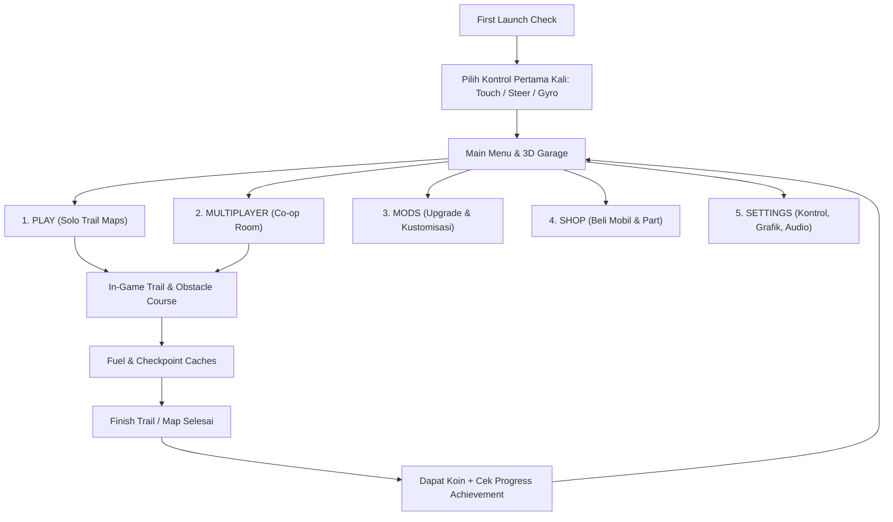

# Game Design Document (GDD) & AI Execution Spec: **Low Range Offroad 4x4 (Android)**

> **Tujuan Dokumen Ini:** Dokumen ini dirancang sebagai spesifikasi *high-level* yang terstruktur, deterministik, dan modular untuk dieksekusi secara bertahap oleh model AI *coding agent* (termasuk model AI skala kecil/menengah). Setiap bagian memiliki batasan teknis jelas agar implementasi tetap ringan, bebas *over-engineering*, dan langsung dapat dijalankan di Android.

---

## 1. Gambaran Umum Proyek (Project Overview)

* **Judul Kerja:** Low Range: Offroad 4x4 Mobile
* **Platform Target:** Android (Minimum Android 8.0 / API 26, Target 60 FPS pada perangkat kelas *low-to-mid range*, ukuran build < 80 MB).
* **Genre:** Technical Offroad 4x4 Trail Simulation (Casual-Friendly).
* **Referensi Utama:** [Roblox - Low Range: Offroad 4x4](https://www.roblox.com/games/88131802740480/Low-Range-Offroad-4x4)
* **Target Pemain:** Casual, umur 13+ (Teen). Cocok untuk sesi bermain singkat (5 sampai 15 menit per jalur/map).
* **Tujuan Utama Game:** Memberikan hiburan santai namun menantang untuk mengisi waktu luang melalui simulasi melewati rintangan alam, memodifikasi suspensi secara interaktif, bermain bersama teman, dan mengumpulkan **Achievement** dari penyelesaian berbagai map.

---

## 2. Rekomendasi Engine Terbaik & Paling Ringan untuk Android

Untuk memastikan performa **paling ringan di Android** sekaligus **paling mudah dieksekusi oleh model AI yang lebih murah/rendah** (karena seluruh scene dan konfigurasi berbasis teks murni), gunakan stack berikut:

* **Engine Utama:** **Godot Engine 4.x** menggunakan **Compatibility Renderer (GLES3 / OpenGL ES 3.0)**.
  * **Alasan Teknis:**
    1. **Sangat Ringan di Android:** Ukuran APK dasar hanya ~25 MB, hemat baterai, dan tidak membebani GPU mobile kelas bawah.
    2. **Fisika Kendaraan Bawaan:** Memiliki node `VehicleBody3D` dan `VehicleWheel3D` yang sudah mendukung simulasi pegas suspensi (*travel, stiffness, damping, rest length*) dan traksi ban secara *out-of-the-box*.
    3. **Ramah AI (AI-Friendly):** Semua file `.tscn` (Scene), `.tres` (Resource), dan `.gd` (GDScript) berupa teks polos yang mudah dibuat dan dimodifikasi oleh LLM tanpa perlu interaksi GUI berat.
* **Alternatif (Jika AI Eksekutor Berjalan di Lingkungan Web/JS):** **Three.js + Rapier3D (atau Cannon-es) + Capacitor Android**. Gunakan alternatif ini hanya jika lingkungan kerja tidak memiliki binary Godot.

---

## 3. Core Loop & Alur Navigasi (Menu Architecture)



### Detail 5 Menu Utama:
1. **Play:** Memilih map/jalur (*Trail*), melihat status penyelesaian map, dan mengecek daftar **Achievement**.
2. **Multiplayer:** Mode Co-op ringan (2 sampai 4 pemain per sesi) untuk konvoi bersama dan saling menarik mobil yang terjebak menggunakan *Winch*.
3. **Mods:** Memasang modifikasi fungsional dan visual pada mobil yang dimiliki (Lift Kit Suspensi, Ban Offroad, Winch, Snorkel, Diff Lock, Roof Rack).
4. **Shop:** Membeli unit kendaraan baru menggunakan mata uang dalam game (*Trail Coins*) yang didapat dari menyelesaikan map dan achievement.
5. **Settings:** Mengganti skema kontrol (**Touch Buttons**, **Steering Wheel**, **Gyro/Tilt**), mengatur sensitivitas kemudi, kualitas grafis (Low/Medium/High), dan volume audio.

---

## 4. Sistem Kontrol (Control Schemes)

Saat pertama kali membuka game (*First-Time User Experience*), tampilkan popup pemilihan kontrol. Pilihan disimpan di `SaveData` dan dapat diubah kapan saja di **Settings**:

| Mode Kontrol | Cara Kerja Kemudi (Steering) | Pedal Gas & Rem |
| :--- | :--- | :--- |
| **1. Touch (Panah)** | Tombol Panah Kiri & Kanan di sisi kiri layar. | Tombol Gas (Maju) & Rem/Mundur di sisi kanan layar. |
| **2. Steer (Setir Virtual)** | Roda setir virtual di sisi kiri layar yang bisa diputar dengan jari (rotasi -450° s/d +450°). | Slider/Tombol Gas & Rem proporsional di sisi kanan layar. |
| **3. Gyro (Tilt Sensor)** | Memiringkan HP ke kiri/kanan menggunakan sensor *Accelerometer/Gyroscope* dengan fitur *Calibrate Center*. | Tombol Gas & Rem di sisi kanan layar. |

---

## 5. Daftar Kendaraan (Playable 4x4 Vehicles)

Terdapat 4 kendaraan utama dengan karakteristik fisika berbeda agar pemain merasakan perbedaan gaya berkendara:

| Kendaraan | Kelas & Peran | Keunggulan Utama | Karakteristik Fisika Dasar |
| :--- | :--- | :--- | :--- |
| **1. Jeep Rubicon** | Rock Crawler (Starter) | *Wheelbase* pendek, sudut *approach/departure* besar, artikulasi suspensi paling lentur. | Massa: Sedang (1.900 kg), Torsi: Tinggi di putaran bawah, Kemudi: Lincah. |
| **2. Isuzu D-Max** | Agile Utility Pickup | Seimbang, hemat bahan bakar, stabil di jalan kerikil (*gravel*) dan tanjakan panjang. | Massa: Ringan-Sedang (1.850 kg), Pusat Gravitasi (CoG): Rendah, Efisiensi BBM: Terbaik. |
| **3. Nissan Patrol** | Overland Expedition SUV | Sasis sangat stabil di medan salju (*snow*), lumpur sedang, dan penyeberangan sungai dalam. | Massa: Berat (2.400 kg), Traksi Ban: Stabil, Kapasitas Tangki BBM: Besar. |
| **4. RAM (1500/2500)** | Heavy Duty Mud Truck | Torsi mesin paling besar untuk menerjang lumpur pekat (*deep mud*) dan menderek beban berat. | Massa: Sangat Berat (2.700 kg), Torsi: Maksimal, *Wheelbase* panjang (butuh ruang putar lebih luas). |

---

## 6. Mekanik Utama & Fitur Khas "Low Range: Offroad 4x4"

### A. Suspensi Interaktif Real-Time (In-Game Active Suspension)
Pemain memiliki panel kontrol cepat di layar (HUD) saat berkendara untuk mengatur suspensi secara langsung tanpa harus keluar ke garasi:
* **Ride Height Slider / Preset (Naik-Turun Suspensi):**
  * **Low (Rendah):** Menurunkan *rest length* pegas dan *Center of Mass*. Membuat mobil stabil dan tidak mudah terguling (*rollover*) saat melaju di jalan **Gravel** atau lereng miring.
  * **Normal (Standar):** Pengaturan seimbang untuk jalur campuran.
  * **High / Lift Mode (Tinggi):** Menaikkan bodi mobil secara visual dan fisik (*ground clearance* bertambah). Wajib digunakan saat melewati **Rock** besar, **Mud** dalam, atau batang pohon agar sasis tidak tersangkut (*high-centered*).
* **Suspension Stiffness Toggle (Soft vs Firm):**
  * **Soft (Empuk):** Roda lebih mudah mengikuti kontur batu (**Rock Crawling**) sehingga keempat ban tetap menapak tanah.
  * **Firm (Keras):** Mencegah bodi memantul berlebihan saat membawa beban atau melewati jalan bergelombang cepat.

### B. Fitur Teknis Offroad (Terinspirasi Game Roblox Low Range)
Agar tetap ramah pemain *casual* namun terasa autentik seperti *Low Range: Offroad 4x4*, sediakan tombol HUD sederhana:
1. **Gearbox Range (`2WD` / `4H` / `4L`):**
   * `2WD`: Hemat bensin, untuk jalan rata/gravel ringan.
   * `4H` (4WD High): Semua roda berputar, cocok untuk salju dan lumpur sedang.
   * `4L` (4WD Low Range): Kecepatan puncak dibatasi rendah, tetapi pengali torsi (*torque multiplier*) meningkat 2.5x untuk memanjat tebing batu curam.
2. **Diff Lock (Differential Lock Toggle):** Mengunci pembagian tenaga antar roda kiri dan kanan agar roda yang menggantung di udara tidak membuang tenaga.
3. **Tire Pressure (`Normal PSI` vs `Air Down / Low PSI`):**
   * Menurunkan tekanan angin ban (*Air Down*) meningkatkan *grip/friction* sebesar +25% di medan **Rock**, **Mud**, dan **Snow**, namun mengurangi kecepatan puncak di jalan keras.
4. **Winch System (Tali Derek Penyelamat):**
   * Jika mobil terjebak di lumpur dalam atau terbalik, pemain menekan tombol **Winch**, lalu tap titik jangkar terdekat (pohon, tiang, batu besar, atau mobil pemain lain di Multiplayer) untuk menarik mobil keluar.
5. **Fuel & Checkpoint Caches:**
   * Setiap jalur memiliki pos kemah/drum bensin. Berhenti di area ini otomatis menyimpan titik *Respawn* (Checkpoint) dan mengisi ulang bahan bakar.

---

## 7. Rintangan & Medan (Terrains & Obstacles)

Setiap medan menggunakan parameter fisika ban dan hambatan yang berbeda:

| Jenis Medan / Rintangan | Parameter Fisika (High-Level) | Tantangan & Cara Melewati |
| :--- | :--- | :--- |
| **1. Mud (Lumpur)** | `Friction: 0.45`, `Linear Drag: Tinggi`, efek roda tenggelam perlahan jika berhenti. | Jangan berhenti di tengah lumpur. Gunakan **Suspensi Tinggi**, **4H/4L**, **Air Down**, atau **Winch** jika terjebak. |
| **2. Snow (Salju & Es)** | `Friction: 0.25` (Sangat licin), `Lateral Grip: Rendah`. | Hindari gas/rem mendadak agar tidak melintir. Gunakan **4H**, **Air Down**, dan jaga momentum halus. |
| **3. Gravel (Kerikil)** | `Friction: 0.65`, permukaan bergelombang kecil, kerikil lepas di tanjakan. | Gunakan **Suspensi Normal/Rendah** agar mobil stabil dan tidak limbung di tikungan. |
| **4. Rock (Bebatuan Terjal)** | `Friction: 0.85`, kemiringan ekstrem, collider batu tidak rata. | Gunakan **Suspensi Tinggi + Soft**, mode **4L**, dan **Diff Lock**. Pilih jalur roda dengan hati-hati agar sasis tidak nyangkut. |
| **5. Water Crossing (Sungai)** *(Tambahan)* | `Buoyancy/Drag Air`, arus menyamping ringan, batas tinggi air (*Water Level*). | Jika air melebihi kap mesin tanpa mod **Snorkel**, mesin akan batuk/mati dan harus di-respawn ke checkpoint. |
| **6. Fallen Logs & Bridges** *(Tambahan)* | Batang kayu licin melintang & jembatan kayu sempit tanpa pagar. | Menguji ketepatan kemudi dan artikulasi suspensi satu per satu roda. |

---

## 8. Sistem Progresi, Map, & Achievement

Game menyediakan minimal **4 Map Bertema** (masing-masing dibagi menjadi 3 *Stage/Checkpoints*):
1. **Map 1: Pinewood Gravel Trail** (Tutorial & Jalur Gravel/Kayu)
2. **Map 2: Muddy Swamp Basin** (Hutan Rawa, Lumpur Dalam, & Sungai)
3. **Map 3: Frostbite Peak** (Jalur Salju Licin & Tanjakan Es)
4. **Map 4: Devil's Canyon Rocks** (Jalur Rock Crawling Ekstrem & Jurang)

### Daftar Achievement Utama:
* **First Trail Completed:** Selesaikan Map 1 dengan kendaraan apa saja. (+500 Koin)
* **Mud Master:** Selesaikan *Muddy Swamp Basin* tanpa kehabisan bahan bakar. (+1.000 Koin)
* **Snow Drifter:** Selesaikan *Frostbite Peak* menggunakan Nissan Patrol atau D-Max. (+1.000 Koin)
* **Rock King:** Selesaikan *Devil's Canyon Rocks* tanpa terbalik (*rollover*). (+1.500 Koin)
* **All-Terrain Explorer:** Selesaikan keempat Map utama. (+3.000 Koin + Badge Emas)
* **Helping Hand:** Gunakan Winch untuk membantu diri sendiri atau pemain lain sebanyak 5 kali. (+500 Koin)
* **Full Garage:** Miliki keempat kendaraan (Jeep Rubicon, RAM, D-Max, Nissan Patrol). (+2.500 Koin)

---

## 9. Instruksi Eksekusi untuk AI Coding Agent (Step-by-Step)

> **PENTING UNTUK AI EKSEKUTOR:** Jangan mencoba membangun seluruh game dalam satu langkah besar. Kerjakan secara bertahap sesuai urutan **Fase 1 hingga Fase 6** di bawah ini. Gunakan aset geometri *low-poly* / *procedural primitives* yang rapi terlebih dahulu agar kode 100% berjalan tanpa bergantung pada aset eksternal berat.

### Aturan Arsitektur (Guardrails untuk AI):
1. **Pisahkan Data dari Logika:** Simpan spesifikasi ke-4 mobil (Jeep Rubicon, RAM, D-Max, Nissan Patrol) dalam file konfigurasi/data (`VehicleData`), bukan *hardcode* di dalam script fisika.
2. **State Management Sederhana:** Gunakan satu *Singleton/Autoload* bernama `GameManager` untuk menyimpan: uang pemain, mobil terpilih, level modifikasi, daftar map yang selesai, achievement yang terbuka, dan pilihan kontrol (`TOUCH`, `STEER`, `GYRO`).
3. **Penyimpanan Lokal:** Simpan seluruh progres ke file JSON lokal (`user://savegame.json` atau `localStorage`) setiap kali pemain menyelesaikan map, membeli item di Shop/Mods, atau mengubah Settings.

### Struktur Direktori yang Diharapkan:
```text
project_root/
├── core/
│   ├── GameManager.(gd/ts)       # Save/Load, Coins, Selected Vehicle, Control Mode
│   └── AchievementManager.(gd/ts)# Pengecekan kondisi & unlock achievement
├── data/
│   ├── vehicles_config.json      # Stat untuk Rubicon, RAM, D-Max, Patrol
│   └── maps_config.json          # Daftar map, checkpoint, dan reward
├── vehicles/
│   ├── BaseVehicle.(gd/ts)       # Logika 4WD (2H/4H/4L), Diff Lock, Air Down, Fuel
│   ├── SuspensionController.(gd/ts) # Logika naik-turun Ride Height & Stiffness real-time
│   └── WinchController.(gd/ts)   # Raycast/jarak ke titik pohon & gaya tarik pegas
├── terrains/
│   ├── SurfaceZone.(gd/ts)       # Pengubah friction & drag (Mud, Snow, Gravel, Rock, Water)
│   └── CheckpointFuel.(gd/ts)    # Trigger isi ulang bensin & simpan posisi respawn
└── ui/
    ├── FirstTimeControlPopup     # Popup pilih Touch / Steer / Gyro saat pertama main
    ├── MainMenuUI                # Navigasi Play, Multiplayer, Mods, Shop, Settings
    └── GameplayHUD               # Kontrol mengemudi + Slider Suspensi + Tombol 4L/Winch/PSI
```

### Rencana Implementasi Bertahap (Execution Phases):

* **Fase 1: Core Architecture, Save System, & First-Time Control Popup**
  * Buat `GameManager` dan sistem Save/Load.
  * Buat layar pembuka yang mendeteksi apakah pemain baru pertama kali masuk (`is_first_launch == true`). Jika ya, tampilkan pilihan kontrol (**Touch**, **Steer**, **Gyro**).
  * Buat **Main Menu** dengan 5 halaman fungsional: **Play**, **Multiplayer**, **Mods**, **Shop**, dan **Settings**.
* **Fase 2: Base Vehicle Physics & Interactive Suspension**
  * Implementasikan kendaraan 4x4 menggunakan fisika roda dan pegas suspensi.
  * Buat `SuspensionController` yang dihubungkan ke **Slider/Tombol HUD** di dalam game sehingga pemain bisa menaikkan dan menurunkan tinggi suspensi (*Ride Height*) secara interaktif saat berkendara, lengkap dengan perubahan visual jarak roda ke bodi.
  * Masukkan konfigurasi stat untuk **Jeep Rubicon**, **RAM**, **Isuzu D-Max**, dan **Nissan Patrol**.
* **Fase 3: Offroad Systems (4L, Diff Lock, Tire PSI, Winch, & Fuel)**
  * Tambahkan tombol HUD untuk `2WD / 4H / 4L`, `Diff Lock`, dan `Tire PSI (Air Down)`.
  * Implementasikan fitur **Winch** (tarik mobil ke titik jangkar terdekat) dan sistem **Fuel + Respawn Checkpoint**.
* **Fase 4: Rintangan Medan (Mud, Snow, Gravel, Rock, Water)**
  * Buat komponen `SurfaceZone` yang mengubah *friction* ban dan *drag* kendaraan saat melewati zona **Mud**, **Snow**, **Gravel**, **Rock**, dan **Water Crossing**.
  * Bangun 4 jalur/map sesuai daftar pada Bagian 8 dengan pos *Fuel Checkpoint* dan garis *Finish*.
* **Fase 5: Shop, Mods, & Achievement System**
  * Hubungkan **Shop** untuk membeli mobil baru dan **Mods** untuk meng-upgrade komponen (Suspensi, Ban, Winch, Snorkel, Tangki BBM).
  * Hubungkan penyelesaian Map ke `AchievementManager` dan tampilkan notifikasi saat Achievement terbuka.
* **Fase 6: Multiplayer Co-op Ringan & Polish Performa Android**
  * Implementasikan modul **Multiplayer** (Lobby pembuatan Room/Join Room sederhana, atau simulasi *Co-op Sync* ringan antar pemain di jalur yang sama).
  * Pastikan seluruh tombol UI memiliki ukuran sentuh minimal `48x48 dp` untuk layar Android dan berjalan stabil di 60 FPS.

---

## 10. Kriteria Penerimaan (Acceptance Criteria / Checklist)

Sebelum menyatakan proyek selesai, AI Eksekutor wajib memastikan seluruh poin berikut terpenuhi:
- [ ] Saat pertama kali dijalankan, muncul pilihan kontrol (**Touch**, **Steer**, **Gyro**) dan bisa diubah kembali di menu **Settings**.
- [ ] Menu utama memiliki 5 fitur lengkap dan berfungsi: **Play**, **Multiplayer**, **Mods**, **Shop**, dan **Settings**.
- [ ] Tersedia 4 kendaraan yang bisa dipilih/dibeli: **Jeep Rubicon**, **RAM**, **Isuzu D-Max**, dan **Nissan Patrol** dengan perbedaan stat yang nyata.
- [ ] Di dalam gameplay terdapat kontrol **Suspensi Interaktif** yang benar-benar menaikkan dan menurunkan bodi/suspensi kendaraan secara real-time.
- [ ] Tersedia rintangan **Mud**, **Snow**, **Gravel**, **Rock**, serta rintangan tambahan (**Water Crossing / Fallen Logs**) yang memengaruhi traksi dan laju mobil.
- [ ] Fitur khas *Low Range: Offroad 4x4* (**4WD Low Range**, **Diff Lock**, **Air Down PSI**, **Winch**, dan **Fuel Checkpoint**) berfungsi di HUD.
- [ ] Menyelesaikan beberapa map membuka **Achievement** dan memberikan hadiah koin yang tersimpan otomatis.

